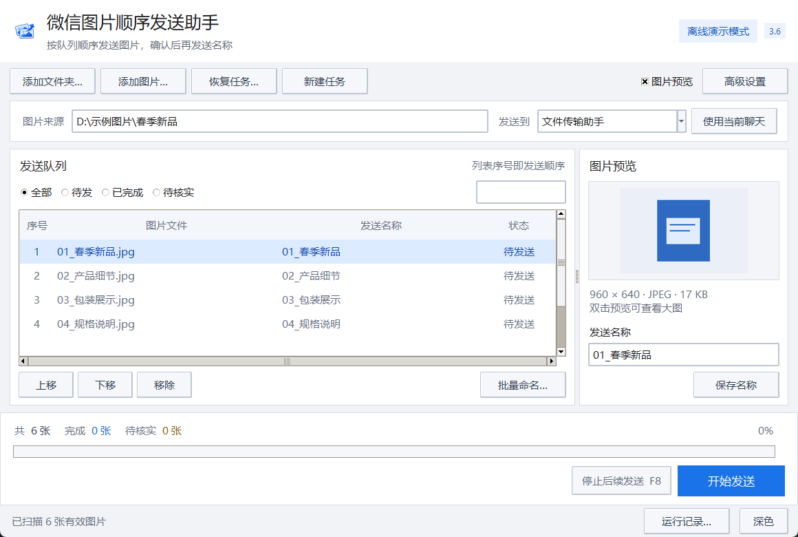

<p align="center">
  
</p>

# 微信图片顺序发送助手 · v3.6.4

面向 Windows 桌面微信的图片队列工具。按照 **图片 → 客户端状态核实 → 图片名称** 逐张处理，支持暂停、人工核实和历史任务恢复。



## 这一版改了什么

- **采用 wcs 参考算法**：使用用户提供版本的逐宽度多尺度匹配、固定聊天区域截图及帧差气泡回退，按“匹配图片 → 等待上传稳定 → 发送名称”处理。移除历史同图计数、滚动证明和新旧图片跟踪门槛。
- **等待图片上传结束再发名称**：保留转圈和失败标记的拦截，图片至少连续稳定 1.5 秒且经过多帧确认后才允许继续；名称提交前再检查一次。转圈暂时不动、聊天画面变化或本地缓存写入均不能跳过确认。
- **窗口截图与显示缩放**：按 wcs 的窗口比例读取聊天区域，不再依赖消息区布局探测；保留较大缩略图尺寸、转圈位置和 DPI 处理。窗口移动、缩放变化或截图方式切换时暂停核实。
- **减少异常后的重复操作**：粘贴操作已尝试后不再用另一套按键重放；旧版尚未完成的图片确认记录恢复时需要人工核实。
- **蓝白桌面工作台**：借鉴 Windows 7 的桌面层次与 Google 风格的简洁排版，集中展示接收对象、图片队列和发送进度；预览、日志与高级设置按需展开。
- **原创程序图标**：叠放照片与发送箭头组成蓝白 Logo，应用于窗口、任务栏和打包资源。
- **列表就是发送顺序**：点击文件名或发送名称表头会调整实际队列；自定义名称跟随对应文件，序号同步更新。
- **恢复时锁定接收对象**：任务开始后保存接收对象、顺序与名称。历史任务继续使用记录中的会话，修改这些内容需新建任务。
- **发送期间保护队列**：禁止导入、改名、移除和调整顺序；扫描结果过期后不会覆盖当前任务。
- **减少界面等待**：扫描、连接检查和预览加载放到后台；速度统计只计算本轮新完成的图片。
- **手动刷新定位聊天**：先在微信中点击目标聊天，再回到程序点击“刷新/定位聊天”。保留手动窗口定位及按键提交方式，不要求 OCR 读出聊天名称。

Windows 7 指的是视觉方向，**运行与打包面向 Windows 10/11**。

## 使用前提与确认范围

真实发送需要已登录的 Windows 桌面微信、可辨认的目标聊天窗口及可读取的本地图片。发送时程序需要操作微信前台窗口与系统剪贴板，请留出操作时间。

默认 `CF_HDROP` 模式把原文件路径放入剪贴板，由微信读取源文件，不改写本地原图。微信如何压缩、展示或传输文件由客户端决定；程序不承诺接收端文件与源文件逐字节相同。`CF_DIB` 是静态位图兼容模式，不能保留动画。

程序通过本地客户端画面、上传状态和文字状态判断是否可以继续。**客户端确认不等于接收方已经收到或阅读**。微信版本、显示缩放、窗口遮挡和网络状况均可能影响识别，无法确认时应暂停并人工核实。

接收对象沿用原版手动定位方式。无法读出具体昵称时显示“当前微信聊天”，仍可使用你已经在微信中打开的聊天；后台连接检查不会替你选择联系人，也不会覆盖手动定位结果。默认不自动搜索或切换会话。

本版保留原版手动定位方式，并加强图片上传结束的判断。本次修正使用人工样张与模拟窗口做离线回归，真实微信发送验证由使用者完成。

## 快速开始

### 从源码运行

准备 Windows 10/11、Python 3.10–3.12（含 Tk）。在项目根目录执行：

```powershell
py -3 -m venv .venv
.\.venv\Scripts\python.exe -m pip install -r requirements.txt
.\.venv\Scripts\python.exe main.py
```

也可以依次双击 `安装依赖.cmd`、`启动程序.cmd`。源码目录中的启动脚本优先运行当前 `main.py`，避免误用旧的已打包 EXE。

### 离线演示与只读诊断

```powershell
# 演示界面，不连接真实微信
.\.venv\Scripts\python.exe main.py --demo

# 自动生成临时样张并运行离线队列
.\.venv\Scripts\python.exe main.py --demo --headless

# 只读检查微信窗口与版本，不发送消息
.\.venv\Scripts\python.exe main.py --diagnose

# 将诊断保存在临时目录，分享前先检查隐私内容
.\.venv\Scripts\python.exe main.py --diagnose --diagnose-output "$env:TEMP\WeChatImageSender-diagnostic.json"
```

### 正常发送

1. 在微信中手动点击需要接收图片的聊天。
2. 回到程序，点击“刷新/定位聊天”；无法读取具体昵称时显示“当前微信聊天”。
3. 导入图片或文件夹，检查顺序、名称和微信发送快捷键，再点击“开始发送”。
4. 需要暂停时点击停止或按 **F8**。等待当前步骤安全结束后，再操作队列或恢复任务。

恢复方法与核实选项见 [使用说明](使用说明.md)。

## 历史任务与数据

任务 JSON 默认保存在 `%LOCALAPPDATA%\WeChatImageSender\jobs`；没有该环境变量时使用用户目录中的 `.wechat_image_sender\jobs`。记录包含接收对象、本地路径、图片名称、摘要与处理状态，不保存原图副本。

“新建任务”只重置界面队列，保留已有任务记录。恢复任务需要源图片仍然存在且通过摘要检查。状态不明的条目必须先人工核实，程序不会直接把它当作未发送重新执行。

任务记录、诊断文件、微信截图和个人图片均属于本地数据，不应提交到公开仓库。反馈问题时使用人工样张，并隐藏会话名称、头像、聊天内容和本地私人路径。

## 项目结构

```text
main.py                       程序入口：正常、演示和诊断模式
wechat_sender/
  gui.py                      窗口整合与桌面交互
  gui_layout.py               蓝白布局、主题和图片预览
  gui_workflow.py             队列编辑、后台扫描、恢复和运行状态
  job_store.py                顺序发送状态机与任务记录
  wechat_adapter.py           微信交互及离线演示适配器
  capture_win32.py            DPI 感知的参考版窗口区域截图
  windows_ocr.py              保留的可选文字识别工具，默认发送流程不依赖它
  image_utils.py              扫描、摘要、命名和画面判断
  clipboard_win32.py          Windows 剪贴板处理
  accessibility.py            Windows 无障碍接口
assets/                       程序 Logo 与图标
tests/                        离线回归测试
docs/                         开发说明、变更记录与公开示例截图
scripts/export_single_file.py 可选单文件导出工具
WeChatImageSender.spec         PyInstaller 打包入口
build.ps1                     本地测试、打包与压缩
WeChatImageSender_v3.py        兼容启动入口，转到 main.py
```

根目录的 `WeChatImageSender_v3.py` 需要完整项目，不再保存一份重复实现。需要独立脚本时，运行 `python scripts/export_single_file.py`，生成文件及所需图标位于 `dist/standalone/`；该目录不纳入源码管理。

## 测试与打包

```powershell
.\.venv\Scripts\python.exe -m unittest discover -s tests -v
powershell -ExecutionPolicy Bypass -File .\build.ps1
```

默认发行输出目录为 `releases/3.6.4/`。发行包包含 Python 与运行依赖，目标电脑无需另装 Python。使用时应完整解压并保留配套资源，不要只复制 `.exe`。本地构建成功不代表 GitHub Release 已发布。

贡献与测试边界见 [开发说明](docs/DEVELOPMENT.md)，版本改动见 [变更记录](docs/CHANGELOG.md)。
